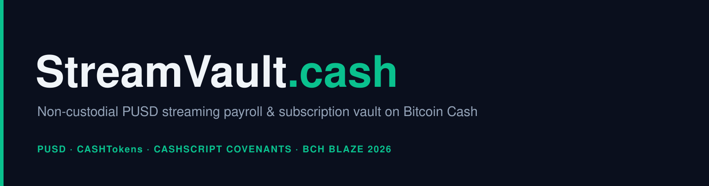
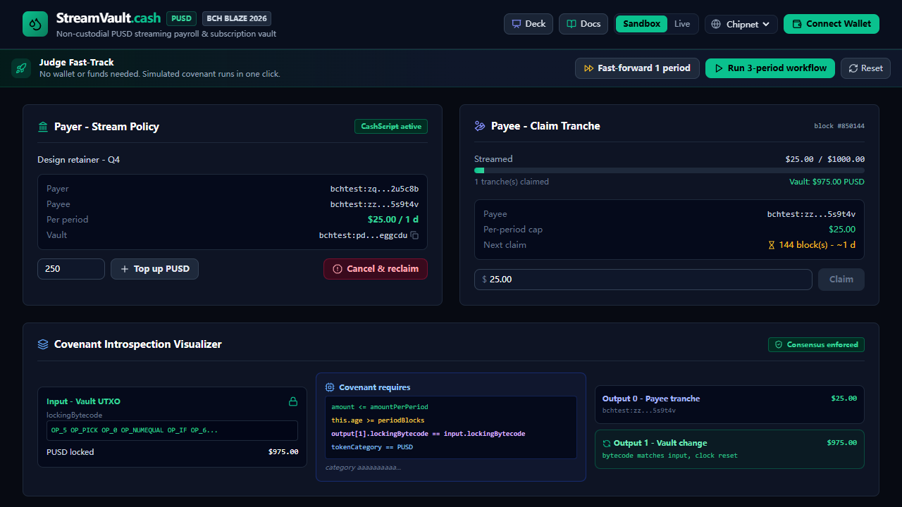

# StreamVault.cash



> Non-custodial **PUSD streaming payroll & subscription vault** on Bitcoin Cash, enforced by CashScript covenants and relative timelocks.

[](https://dorahacks.io/hackathon/bchblaze2026)
[](LICENSE)
[](https://cashscript.org/)
[](https://bitcoincash.org)

> **Live demo:** https://streamvault-cash.vercel.app  ·  built for BCH BLAZE 2026

---

## What it is

StreamVault.cash lets a payer lock **PUSD (ParyonUSD)** - a CashTokens stablecoin pegged to USD - inside a
Bitcoin Cash covenant and release it to a payee as a **money stream**. The payee may withdraw at most
`amountPerPeriod` PUSD per `periodBlocks` blocks; the payer can cancel and reclaim the unstreamed balance
at any time. Everything is enforced by the Bitcoin Cash VM - no custodial server, no chargebacks, no
infinite billing loops.

Typical uses:

- **Freelance / contractor payroll** - a monthly retainer that the contractor draws down per period.
- **SaaS subscriptions** - a prepaid budget that releases a tranche per cycle.
- **Creator / grant streams** - continuous funding that stays cancellable by the sponsor.

---



## Why Bitcoin Cash

- **Sub-cent settlement**: BCH fees (~1 sat/byte) make per-period micro-settlement economically viable.
- **UTXO covenants**: introspection opcodes let the contract *prove* that change returns to the identical
  spending condition (`output[1].lockingBytecode == input[0].lockingBytecode`).
- **Relative timelocks**: `this.age` (OP_CHECKSEQUENCEVERIFY) natively encodes "at least N blocks since this
  UTXO", which is exactly a rate limit for a stream.
- **CashTokens**: PUSD is a native fungible token, so the covenant can enforce token conservation on-chain.

---

## How the covenant works

`contracts/StreamVault.cash` (CashScript `^0.14.0`):

```
contract StreamVault(pubkey payerPk, pubkey payeePk, int amountPerPeriod, int periodBlocks, bytes pusdCategory)
```

- `claim(sig payeeSig, int amount)`
  - `checkSig(payeeSig, payeePk)` - only the payee can pull a tranche.
  - `this.age >= periodBlocks` - relative period must have elapsed.
  - `amount > 0 && amount <= amountPerPeriod` - per-period ceiling.
  - `tx.outputs.length == 2` - the payee tranche plus the vault change; no third output can siphon the BCH buffer.
  - Output 0 carries exactly `amount` PUSD to the payee (`tokenCategory == pusdCategory`).
  - Output 1 carries the remaining PUSD back to the **identical covenant bytecode**; the new UTXO restarts the clock.
- `cancel(sig payerSig, bytes payerLockingBytecode)`
  - The payer signature sweeps **100%** of the remaining PUSD to a payer-selected address.

Token conservation is guaranteed by the VM: a claim can never drain the vault (the covenant requires a
positive remainder), so only the payer's `cancel` can empty it.

See [docs/STREAM_MECHANICS.md](docs/STREAM_MECHANICS.md) for the full mechanics, edge cases and the
"why relative locks" rationale.

---

## Quick start

```bash
npm install
npm run compile   # cashc contracts/StreamVault.cash -> contracts/artifacts/StreamVault.json
npm test          # 9 covenant tests evaluated against the real BCH VM (MockNetworkProvider)
npm run dev       # http://localhost:5173
```

Open `http://localhost:5173` and use the **Judge Fast-Track**: *Launch demo stream* -> *Fast-forward 1 period*
-> *Claim* -> *Cancel & reclaim*. The sandbox mirrors every covenant rule, so no wallet or testnet coins are
required.

---

## Test suite

- `npm test` - the covenant against the **real BCH VM** (`contracts/test-streamvault.mjs`, `MockNetworkProvider`).
- `npm run test:engine` - sandbox engine invariants (`tests/stream.test.ts`).
- `npm run test:derive` - offline covenant address derivation for Chipnet/Mainnet (`tests/derive.ts`).
- `npm run test:chain` - the live layer builds VM-accepted `claim`/`cancel` txs and WalletConnect objects (`tests/chain.test.ts`).


The covenant suite loads the compiled artifact, instantiates the covenant
on a `MockNetworkProvider` (real VM validation) and asserts both accepted and rejected paths:

| Test | Scenario | Expectation |
| :--- | :--- | :--- |
| TEST-00 | Artifact / ABI (`claim`, `cancel`) | compiles |
| TEST-01 | Valid claim (800 <= 1000) | VM accepts |
| TEST-02 | Over-limit claim (2500 > 1000) | covenant reverts |
| TEST-03 | Claim before the period elapsed | covenant reverts |
| TEST-04 | Change redirected to an attacker | covenant reverts |
| TEST-05 | Zero-amount claim | covenant reverts |
| TEST-06 | Payer cancel sweeps 100% | VM accepts |
| TEST-07 | Cancel with a non-payer key | covenant reverts |
| TEST-08 | Broadcast updates the covenant UTXO | stream continues |

---

## Project layout

```
StreamVault.cash/
├── contracts/
│   ├── StreamVault.cash            # the covenant
│   ├── test-streamvault.mjs        # real VM test suite
│   └── artifacts/StreamVault.json  # compiled artifact (committed for judge convenience)
├── src/
│   ├── components/                 # React cockpit (Header, StreamControls, ClaimPanel, ...)
│   ├── lib/
│   │   ├── covenant.ts             # artifact + PUSD/network constants + address config
│   │   ├── stream.ts               # sandbox engine mirroring the covenant invariants
│   │   ├── chain.ts                # live layer: Electrum provider, contract, real tx building
│   │   └── format.ts               # PUSD/BCH formatting
│   └── types/
└── docs/                           # PRD, ARCHITECTURE, SECURITY, STREAM_MECHANICS, SLIDES, ...
```

---

## Live settlement

`src/lib/chain.ts` wires the real stack: `ElectrumNetworkProvider` for Chipnet/Mainnet, `Contract`
instantiation, live UTXO/Tokens queries, and real `claim` transaction building. Wallet signing goes through
**WizardConnect** (`@wizardconnect/react` + `@wizardconnect/dapp`), so no private key is ever stored in the
browser. See [docs/ARCHITECTURE.md](docs/ARCHITECTURE.md) for the signing flow.

---

## Compliance (BCH BLAZE 2026)

See [docs/COMPLIANCE.md](docs/COMPLIANCE.md) for the seven mandatory requirements checklist.

## Roadmap

1. **Hackathon MVP** - covenant, cockpit, Chipnet + Mainnet settlement.
2. **SDK + MCP server** - let AI agents stream a per-call PUSD budget.
3. **Marketplace** - a directory of PUSD-denominated recurring services.

## License

MIT (c) 2026 StreamVault.cash contributors