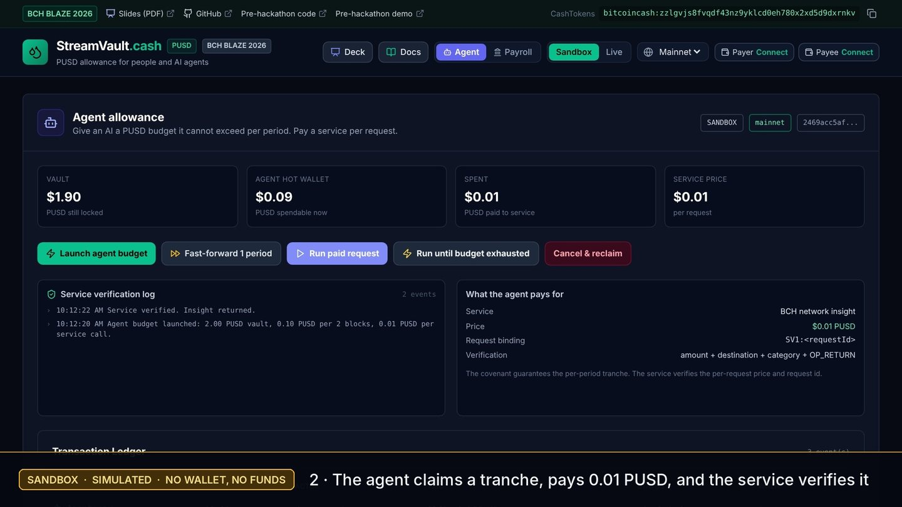
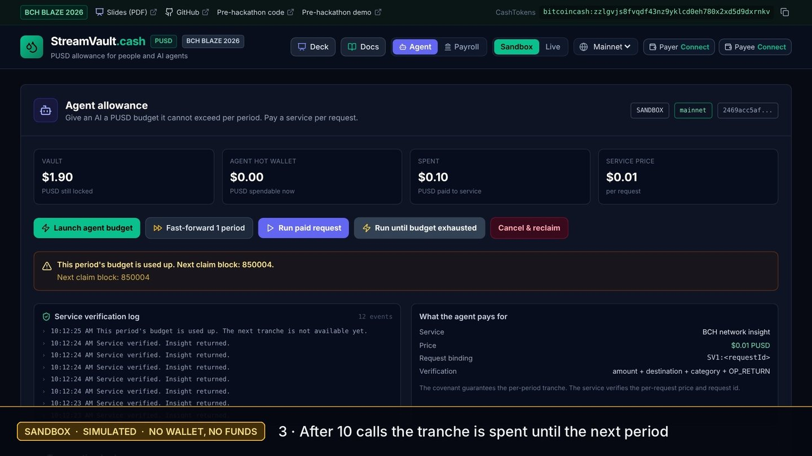
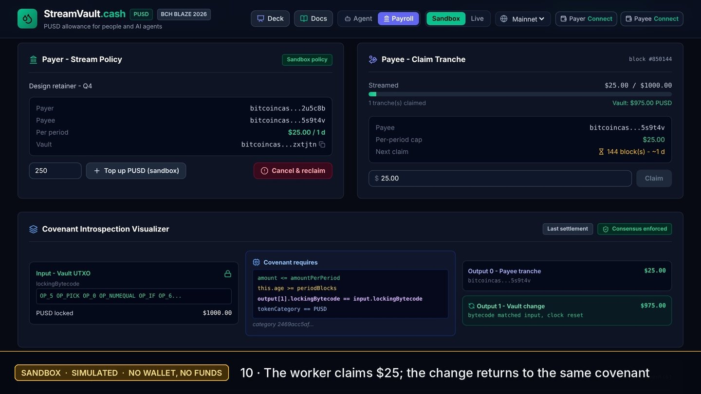

# Judge walkthrough (60 seconds)

Open https://streamvault-cash.vercel.app. The page opens on **Agent → Sandbox**. No wallet, coins or
local build is needed.

**What is real and what is simulated**

| Where | What it is |
| :--- | :--- |
| **Sandbox** (default) | Simulated. A local engine mirrors the covenant rules; nothing touches a chain. Ledger rows say `simulated`. |
| **Chipnet** | Real BCH test network, test tokens with no value. The full two-wallet lifecycle was confirmed on 2026-11-02 with Cashonize web wallets: [CHIPNET_EVIDENCE.md](CHIPNET_EVIDENCE.md). |
| **Live → Mainnet** | Real BCH Mainnet with real PUSD. Needs a WizardConnect wallet and a funded vault. Current status: [README → Status](../README.md#status). |

## Watch first (48 s, Sandbox)

[Sandbox walkthrough video](https://streamvault-cash.vercel.app/judge/streamvault-sandbox-demo.mp4):
the Agent path below, then the Payroll claim. Every frame is labelled *Sandbox · simulated*.

| Paid request verified | Budget used up | Payroll claim settlement |
| :---: | :---: | :---: |
|  |  |  |

More: [cancel and reclaim](judge/03-agent-cancel-reclaim.jpg), [phone layout](judge/05-mobile-agent.jpg).

## Agent path (Sandbox)

1. Keep **Agent** selected and **Sandbox** active.
2. Click **Launch agent budget**. A 2.00 PUSD vault is created with a 0.10 PUSD tranche every 2 blocks.
3. Click **Run paid request**. The agent claims 0.10 PUSD, pays 0.01 PUSD to the service, and the
   service log shows `Service verified. Insight returned.`
4. Click **Run until budget exhausted**. After 10 calls the UI shows **This period's budget is used
   up** and the next claim block. In Sandbox the engine simulates the covenant's relative period gate;
   on chain the covenant itself enforces it (see the Chipnet claims).
5. Click **Fast-forward 1 period** and **Run paid request** again: the next tranche is available.
6. Click **Cancel & reclaim**. The payer takes back what is left in the vault; the agent key can no
   longer claim from it.

## Payroll path (Sandbox)

Switch to **Payroll** and click **Launch Demo Stream ($1,000 payroll)**. Click **Fast-forward 1 period**,
then **Claim** $25. The Covenant Introspection Visualizer shows the settlement: output 0 is the $25
tranche, output 1 returns the $975 change to the same covenant bytecode and restarts the clock.

## Live mode

**Live** reads and writes the real chain selected in the network menu. Payroll connects separate payer
and payee wallets through WizardConnect, both signing with their `receive/0` key. The Agent view uses
the server-side agent key as the payee and hot wallet. Mainnet transactions are listed only after they
are confirmed; until then the Mainnet evidence strip stays hidden.

## Key files

- Covenant: `contracts/StreamVault.cash`
- Real VM tests: `contracts/test-streamvault.mjs` (`npm test`, 21 cases)
- Chain layer: `src/lib/chain.ts`
- Wallet manager: `src/wallet/WalletProvider.tsx`, session logic `src/wallet/session.ts`
- Agent API: `src/lib/agent-server.ts`, `api/agent/*`, `api/service/insight.ts`
- Mechanics: `docs/STREAM_MECHANICS.md`
